# Model Input Datasets

[`library`](https://rdrr.io/r/base/library.html)`(`[`whychusModel`](https://flowwest.github.io/udwc_temperature/)`)`` `[`library`](https://rdrr.io/r/base/library.html)`(`[`dplyr`](https://dplyr.tidyverse.org)`)`` `[`library`](https://rdrr.io/r/base/library.html)`(`[`tidyr`](https://tidyr.tidyverse.org)`)`` `[`library`](https://rdrr.io/r/base/library.html)`(`[`ggplot2`](https://ggplot2.tidyverse.org)`)`

This vignette is a reference for every dataset shipped with
`whychusModel`. Each section gives a short description, where the data
came from, the date range currently held, and a simple exploratory plot.

The datasets are grouped by whether the RM 8.5 delta model actually
consumes them. Several were compiled during earlier exploration and are
retained because they are useful context, not because the model uses
them — that distinction is called out in each section so nobody wires an
unused series into a future model by accident.

All compilation code lives in
[`data-raw/pull-historical-data.Rmd`](https://github.com/FlowWest/udwc_temperature/blob/main/data-raw/pull-historical-data.Rmd)
unless a section says otherwise. The datasets are rebuilt by re-knitting
that document, which calls
[`usethis::use_data()`](https://usethis.r-lib.org/reference/use_data.html)
on each object.

`# Consistent palette across the sections below.`` ``stat_colors`` ``<-`` `[`c`](https://rdrr.io/r/base/c.html)`(``"7DADM"`` ``=`` ``"#7B1E1E"``, ``"max"`` ``=`` ``"#F0A202"``, ``"mean"`` ``=`` ``"#899DA4"``,`` `` ``"median"`` ``=`` ``"#9A8822"``, ``"min"`` ``=`` ``"#74A089"``)`` `` ``# Three overlapping daily series across a decade of record smear together at`` ``# this width, and because ggplot draws colour groups in level order "7DADM"`` ``# lands underneath "max" and "min" — recolouring alone cannot rescue it. These`` ``# plots give each series a different visual role instead: the daily min-max`` ``# spread becomes a filled envelope, the daily max a hairline on its upper`` ``# edge, and 7DADM a heavier line drawn last, on top of everything.`` ``band_colors`` ``<-`` `[`c`](https://rdrr.io/r/base/c.html)`(``"Daily min–max range"`` ``=`` ``"#BFCEDA"``,`` `` ``"Daily max"`` ``=`` ``"#F0A202"``,`` `` ``"7DADM"`` ``=`` ``"#7B1E1E"``)`` `` ``plot_instream`` ``<-`` ``function``(``df``, ``title``, ``subtitle`` ``=`` ``NULL``, ``threshold`` ``=`` ``NULL``)`` ``{`` `` ``wide`` ``<-`` ``df`` ``|>`` `` `[`mutate`](https://dplyr.tidyverse.org/reference/mutate.html)`(``date ``=`` `[`as.Date`](https://rdrr.io/r/base/as.Date.html)`(``date``)``)`` ``|>`` `` `[`filter`](https://dplyr.tidyverse.org/reference/filter.html)`(``statistic`` `[`%in%`](https://rdrr.io/r/base/match.html)` `[`c`](https://rdrr.io/r/base/c.html)`(``"7DADM"``, ``"max"``, ``"min"``)``)`` ``|>`` `` `[`distinct`](https://dplyr.tidyverse.org/reference/distinct.html)`(``date``, ``statistic``, .keep_all ``=`` ``TRUE``)`` ``|>`` `` `[`select`](https://dplyr.tidyverse.org/reference/select.html)`(``date``, ``statistic``, ``temperature``)`` ``|>`` `` `[`pivot_wider`](https://tidyr.tidyverse.org/reference/pivot_wider.html)`(``names_from ``=`` ``statistic``, values_from ``=`` ``temperature``)`` ``|>`` `` `[`arrange`](https://dplyr.tidyverse.org/reference/arrange.html)`(``date``)`` ``|>`` `` ``# Insert the absent calendar days so the line and ribbon break over`` `` ``# winter deployment gaps instead of drawing straight across them.`` `` `[`complete`](https://tidyr.tidyverse.org/reference/complete.html)`(``date ``=`` `[`seq`](https://rdrr.io/r/base/seq.html)`(`[`min`](https://rdrr.io/r/base/Extremes.html)`(``date``)``, `[`max`](https://rdrr.io/r/base/Extremes.html)`(``date``)``, by ``=`` ``"day"``)``)`` `` `` ``p`` ``<-`` `[`ggplot`](https://ggplot2.tidyverse.org/reference/ggplot.html)`(``wide``, `[`aes`](https://ggplot2.tidyverse.org/reference/aes.html)`(``x ``=`` ``date``)``)`` ``+`` `` `[`geom_ribbon`](https://ggplot2.tidyverse.org/reference/geom_ribbon.html)`(`[`aes`](https://ggplot2.tidyverse.org/reference/aes.html)`(``ymin ``=`` ``min``, ymax ``=`` ``max``, fill ``=`` ``"Daily min–max range"``)``)`` ``+`` `` `[`geom_line`](https://ggplot2.tidyverse.org/reference/geom_path.html)`(`[`aes`](https://ggplot2.tidyverse.org/reference/aes.html)`(``y ``=`` ``max``, colour ``=`` ``"Daily max"``)``, linewidth ``=`` ``0.2``)`` ``+`` `` `[`geom_line`](https://ggplot2.tidyverse.org/reference/geom_path.html)`(`[`aes`](https://ggplot2.tidyverse.org/reference/aes.html)`(``y ``=`` ``` `7DADM` ```, colour ``=`` ``"7DADM"``)``, linewidth ``=`` ``0.45``)`` `` `` ``if`` ``(``!`[`is.null`](https://rdrr.io/r/base/NULL.html)`(``threshold``)``)`` ``{`` `` ``p`` ``<-`` ``p`` ``+`` `[`geom_hline`](https://ggplot2.tidyverse.org/reference/geom_abline.html)`(``yintercept ``=`` ``threshold``, linetype ``=`` ``"dashed"``,`` `` colour ``=`` ``"grey30"``, linewidth ``=`` ``0.4``)`` `` ``}`` `` `` ``p`` ``+`` `` `[`scale_fill_manual`](https://ggplot2.tidyverse.org/reference/scale_manual.html)`(``values ``=`` ``band_colors``)`` ``+`` `` `[`scale_colour_manual`](https://ggplot2.tidyverse.org/reference/scale_manual.html)`(``values ``=`` ``band_colors``,`` `` breaks ``=`` `[`c`](https://rdrr.io/r/base/c.html)`(``"7DADM"``, ``"Daily max"``)``)`` ``+`` `` `[`guides`](https://ggplot2.tidyverse.org/reference/guides.html)`(``colour ``=`` `[`guide_legend`](https://ggplot2.tidyverse.org/reference/guide_legend.html)`(``order ``=`` ``1``)``, fill ``=`` `[`guide_legend`](https://ggplot2.tidyverse.org/reference/guide_legend.html)`(``order ``=`` ``2``)``)`` ``+`` `` `[`labs`](https://ggplot2.tidyverse.org/reference/labs.html)`(``title ``=`` ``title``, subtitle ``=`` ``subtitle``, x ``=`` ``NULL``, y ``=`` ``"°C"``)`` ``+`` `` ``theme_inputs``(``)`` ``}`` `` ``# Compact coverage summary used in every section.`` ``coverage`` ``<-`` ``function``(``dates``)`` ``{`` `` ``d`` ``<-`` `[`as.Date`](https://rdrr.io/r/base/as.Date.html)`(``dates``)`` `` ``d`` ``<-`` ``d``[``!`[`is.na`](https://rdrr.io/r/base/NA.html)`(``d``)``]`` `` `[`data.frame`](https://rdrr.io/r/base/data.frame.html)`(`` `` start ``=`` `[`format`](https://rdrr.io/r/base/format.html)`(`[`min`](https://rdrr.io/r/base/Extremes.html)`(``d``)``)``,`` `` end ``=`` `[`format`](https://rdrr.io/r/base/format.html)`(`[`max`](https://rdrr.io/r/base/Extremes.html)`(``d``)``)``,`` `` n_days ``=`` `[`length`](https://rdrr.io/r/base/length.html)`(`[`unique`](https://rdrr.io/r/base/unique.html)`(``d``)``)``,`` `` n_rows ``=`` `[`length`](https://rdrr.io/r/base/length.html)`(``d``)``,`` `` n_years ``=`` `[`length`](https://rdrr.io/r/base/length.html)`(`[`unique`](https://rdrr.io/r/base/unique.html)`(`[`format`](https://rdrr.io/r/base/format.html)`(``d``, ``"%Y"``)``)``)`` `` ``)`` ``}`` `` ``theme_inputs`` ``<-`` ``function``(``)`` ``{`` `` `[`theme_minimal`](https://ggplot2.tidyverse.org/reference/ggtheme.html)`(``base_size ``=`` ``11``)`` ``+`` `` `[`theme`](https://ggplot2.tidyverse.org/reference/theme.html)`(``panel.grid.minor ``=`` `[`element_blank`](https://ggplot2.tidyverse.org/reference/element.html)`(``)``,`` `` legend.position ``=`` ``"top"``,`` `` legend.title ``=`` `[`element_blank`](https://ggplot2.tidyverse.org/reference/element.html)`(``)``,`` `` plot.title ``=`` `[`element_text`](https://ggplot2.tidyverse.org/reference/element.html)`(``face ``=`` ``"bold"``, size ``=`` ``11``)``)`` ``}`

### Coverage at a glance

[`bind_rows`](https://dplyr.tidyverse.org/reference/bind_rows.html)`(`` `` `[`cbind`](https://rdrr.io/r/base/cbind.html)`(``dataset ``=`` ``"rm_8_5_historical"``, ``coverage``(``rm_8_5_historical``$``date``)``)``,`` `` `[`cbind`](https://rdrr.io/r/base/cbind.html)`(``dataset ``=`` ``"camp_polk_temperature_historical"``, ``coverage``(``camp_polk_temperature_historical``$``date``)``)``,`` `` `[`cbind`](https://rdrr.io/r/base/cbind.html)`(``dataset ``=`` ``"camp_polk_flow_historical"``, ``coverage``(``camp_polk_flow_historical``$``date``)``)``,`` `` `[`cbind`](https://rdrr.io/r/base/cbind.html)`(``dataset ``=`` ``"dynamical_gfs_forecasts"``, ``coverage``(``dynamical_gfs_forecasts``$``valid_date``)``)``,`` `` `[`cbind`](https://rdrr.io/r/base/cbind.html)`(``dataset ``=`` ``"all_historical_forecasts"``, ``coverage``(``all_historical_forecasts``$``valid_date``)``)``,`` `` `[`cbind`](https://rdrr.io/r/base/cbind.html)`(``dataset ``=`` ``"sisters_air_temp_historical"``, ``coverage``(``sisters_air_temp_historical``$``date``)``)``,`` `` `[`cbind`](https://rdrr.io/r/base/cbind.html)`(``dataset ``=`` ``"sisters_precip_historical"``, ``coverage``(``sisters_precip_historical``$``date``)``)``,`` `` `[`cbind`](https://rdrr.io/r/base/cbind.html)`(``dataset ``=`` ``"rm_6_historical"``, ``coverage``(``rm_6_historical``$``date``)``)``,`` `` `[`cbind`](https://rdrr.io/r/base/cbind.html)`(``dataset ``=`` ``"whychus_nr_sisters_historical"``, ``coverage``(``whychus_nr_sisters_historical``$``date``)``)``,`` `` `[`cbind`](https://rdrr.io/r/base/cbind.html)`(``dataset ``=`` ``"whychus_at_sisters_historical"``, ``coverage``(``whychus_at_sisters_historical``$``date``)``)`` ``)`` ``|>`` `` ``knitr``::`[`kable`](https://rdrr.io/pkg/knitr/man/kable.html)`(``caption ``=`` ``"Date coverage of every dataset described in this vignette."``)`

| dataset                          | start      | end        | n_days | n_rows | n_years |
|:---------------------------------|:-----------|:-----------|-------:|-------:|--------:|
| rm_8_5_historical                | 2011-04-28 | 2025-10-29 |   2855 |  14275 |      14 |
| camp_polk_temperature_historical | 2012-05-29 | 2026-04-14 |   4619 |  19127 |      15 |
| camp_polk_flow_historical        | 2011-05-01 | 2026-04-20 |   5469 |   5469 |      16 |
| dynamical_gfs_forecasts          | 2021-05-02 | 2026-09-07 |   1955 |  40929 |       6 |
| all_historical_forecasts         | 2011-01-01 | 2026-08-04 |   5695 |  66999 |      16 |
| sisters_air_temp_historical      | 1979-01-01 | 2025-12-31 |  17167 |  17167 |      47 |
| sisters_precip_historical        | 1979-01-01 | 2025-12-31 |  17167 |  17167 |      47 |
| rm_6_historical                  | 2012-04-23 | 2025-10-17 |   2492 |  12460 |      13 |
| whychus_nr_sisters_historical    | 2011-01-01 | 2026-04-15 |   5584 |  16855 |      16 |
| whychus_at_sisters_historical    | 2001-01-01 | 2026-06-10 |   9292 |   9292 |      26 |

Date coverage of every dataset described in this vignette. {.table}

The model is fit on the intersection of these ranges, restricted to May
through October. That intersection is bounded on the left by the
dynamical.org archive (2021-05-01) and on the right by the most recent
RM 8.5 logger download.

------------------------------------------------------------------------

## Part 1 — Datasets the RM 8.5 model uses

### 1.1 RM 8.5 in-stream temperature

The forecast site, and the source of both the prediction target and the
model’s persistence anchor. A single HOBO data logger deployed by the
Upper Deschutes Watershed Council at Whychus Creek river mile 8.5,
downstream of Rimrock Ranch. Sub-daily readings are aggregated to daily
`mean`, `median`, `max` and `min`, and the `7DADM` statistic is a
right-aligned 7-day rolling mean of the daily maxima.

Three quantities in the model come from this dataset:

- `rm_8_5_7dadm` — the prediction target (via the `7DADM` statistic)
- `dadm_m0` — the same series read on the run date; the value the
  predicted change is added back to
- `tmax_m0`, `dadm_trend`, `tmax_trend` — today’s daily max and the
  5-day slopes of both series

**Source.** UDWC continuous temperature monitoring program, monitoring
location `WC_008-50`. Compiled from the annual Excel submittals in
`data-raw/historical-temperature/`, one workbook per year from 2011 to
2025. In-season 2026 readings arrive as separate logger exports and are
bound on at model-fit time rather than being baked into the package
object.

`coverage``(``rm_8_5_historical``$``date``)`` ``|>`` ``knitr``::`[`kable`](https://rdrr.io/pkg/knitr/man/kable.html)`(``)`

| start      | end        | n_days | n_rows | n_years |
|:-----------|:-----------|-------:|-------:|--------:|
| 2011-04-28 | 2025-10-29 |   2855 |  14275 |      14 |

`plot_instream``(`` `` ``rm_8_5_historical``,`` `` title ``=`` ``"RM 8.5 in-stream temperature"``,`` `` subtitle ``=`` ``"Dashed line is the 20 °C HCP threshold"``,`` `` threshold ``=`` ``20`` ``)`

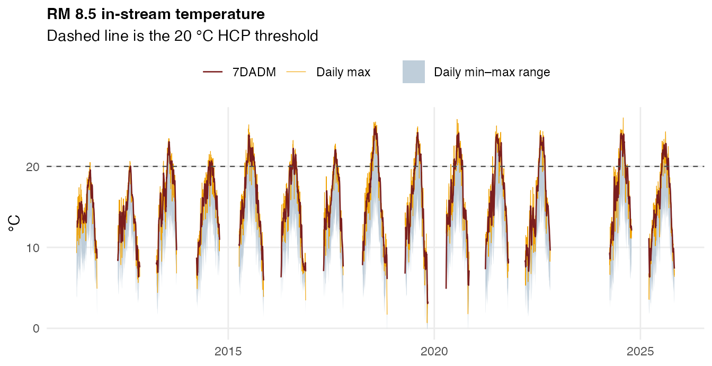

Coverage is seasonal — the logger is pulled over winter in most years,
so the gaps between roughly November and April are deployment gaps, not
missing data.

### 1.2 Camp Polk water temperature

The upstream boundary condition, about 11 river miles above RM 8.5.
Water arriving at RM 8.5 has passed Camp Polk a short time earlier, so
this is the single most informative non-local predictor in the set.
Supplies `cp_7dadm`, `cp_tmax` and `cp_7dadm_trend`.

**Source.** Two sources merged into one series:

- Oregon Water Resources Department station **14076100**, pulled through
  [`get_owrd_hydro()`](https://flowwest.github.io/udwc_temperature/reference/get_owrd_hydro.md)
  (`WTEMP_MEAN` / `WTEMP_MIN` / `WTEMP_MAX`) from 2011-05-01 forward
- The UDWC HOBO logger at monitoring location `WC_019-50`, described as
  “d/s Camp Polk Bridge on DBLT property”

Where the two overlap the UDWC logger takes precedence — the OWRD record
is anti-joined against the logger record before the two are bound, so
the logger fills the gaps in OWRD telemetry rather than being averaged
with it. `7DADM` is computed after the merge, as a right-aligned 7-day
rolling mean of daily maxima.

`coverage``(``camp_polk_temperature_historical``$``date``)`` ``|>`` ``knitr``::`[`kable`](https://rdrr.io/pkg/knitr/man/kable.html)`(``)`

| start      | end        | n_days | n_rows | n_years |
|:-----------|:-----------|-------:|-------:|--------:|
| 2012-05-29 | 2026-04-14 |   4619 |  19127 |      15 |

`plot_instream``(`` `` ``camp_polk_temperature_historical``,`` `` title ``=`` ``"Camp Polk water temperature (OWRD 14076100 + UDWC WC_019-50)"`` ``)`

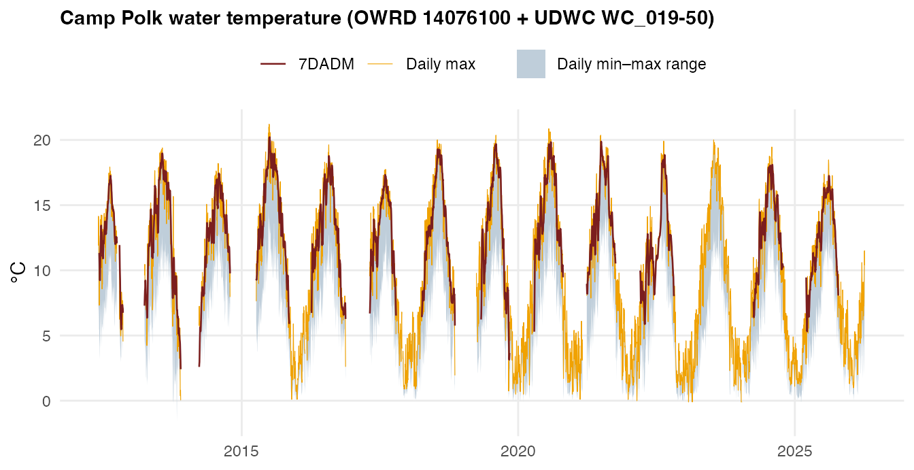

### 1.3 Camp Polk discharge

Mean daily flow at the same station. Flow is the volume term behind the
temperature signal: a given amount of solar heating raises a low-flow
creek further than a high-flow one, so discharge conditions how strongly
air temperature translates into water temperature. Supplies
`cp_flow_mean` and `cp_flow_trend`.

**Source.** OWRD station **14076100**, `MDF` (mean daily flow) series,
via
[`get_owrd_hydro()`](https://flowwest.github.io/udwc_temperature/reference/get_owrd_hydro.md).

`coverage``(``camp_polk_flow_historical``$``date``)`` ``|>`` ``knitr``::`[`kable`](https://rdrr.io/pkg/knitr/man/kable.html)`(``)`

| start      | end        | n_days | n_rows | n_years |
|:-----------|:-----------|-------:|-------:|--------:|
| 2011-05-01 | 2026-04-20 |   5469 |   5469 |      16 |

`camp_polk_flow_historical`` ``|>`` `` `[`ggplot`](https://ggplot2.tidyverse.org/reference/ggplot.html)`(`[`aes`](https://ggplot2.tidyverse.org/reference/aes.html)`(`[`as.Date`](https://rdrr.io/r/base/as.Date.html)`(``date``)``, ``flow_cfs``)``)`` ``+`` `` `[`geom_line`](https://ggplot2.tidyverse.org/reference/geom_path.html)`(``linewidth ``=`` ``0.3``, colour ``=`` ``"#378ADD"``)`` ``+`` `` `[`scale_y_log10`](https://ggplot2.tidyverse.org/reference/scale_continuous.html)`(``)`` ``+`` `` `[`labs`](https://ggplot2.tidyverse.org/reference/labs.html)`(``title ``=`` ``"Camp Polk mean daily discharge"``, x ``=`` ``NULL``,`` `` y ``=`` ``"cfs (log scale)"``)`` ``+`` `` ``theme_inputs``(``)`

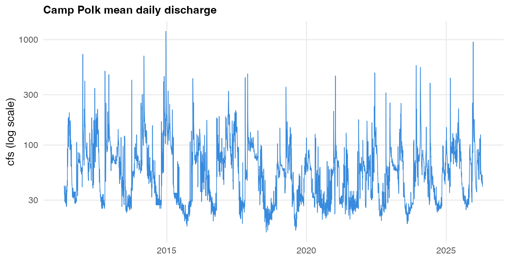

Plotted on a log scale because spring freshet peaks are one to two
orders of magnitude above summer baseflow, and it is the summer baseflow
range that the model is fit on.

### 1.4 dynamical.org GFS air-temperature forecasts

The weather side of the model, and the only input that is a *forecast*
rather than an observation. Supplies the full day-1-through-day-k
trajectory — `air_max_d*`, `air_min_d*`, `cloud_d*` — and the four
`traj_` summaries derived from it.

**Source.** [dynamical.org](https://dynamical.org) republishes NOAA’s
Global Forecast System output as analysis-ready Icechunk/Zarr on public
S3 (`s3://dynamical-noaa-gfs`, region `us-west-2`). We extract the
nearest grid cell to 44.390278 °N, −121.406792 °W from the 00Z
initialisation, tiling the model’s four 6-hour windows to form
calendar-day maxima, minima and cloud means at leads 1 through 7.

The Icechunk/Zarr stack has no R client, so the pull is a Python script,
`data-raw/pull_dynamical_forecasts.py`. It writes
`data-raw/dynamical_gfs_air_temp_historical.csv`, which is the working
file the puller appends to:

``` bash
# full history (the dynamical.org archive begins 2021-05-01)
/opt/miniconda3/bin/python3 data-raw/pull_dynamical_forecasts.py \
  --start-date 2021-05-01 --end-date 2026-09-07

# extend an existing file; dedupes on init_date, lead_days, variable
/opt/miniconda3/bin/python3 data-raw/pull_dynamical_forecasts.py \
  --start-date 2026-09-01 --append
```

`dynamical_gfs_forecasts` is the packaged snapshot of that CSV, built by
the dynamical.org chunk in `pull-historical-data.Rmd`. The CSV stays the
working file so the Python puller can extend it without a package
rebuild; re-knit that chunk to bring the data object up to date with it.

Its columns match `all_historical_forecasts` apart from that object’s
`type` column, so the two archives can be compared or swapped directly.
The reasoning behind choosing this source over the alternatives is in
the [Choosing an Air Temperature Forecast
Source](https://flowwest.github.io/udwc_temperature/articles/air-temperature-source.md)
vignette.

`coverage``(``dynamical_gfs_forecasts``$``valid_date``)`` ``|>`` ``knitr``::`[`kable`](https://rdrr.io/pkg/knitr/man/kable.html)`(``)`

| start      | end        | n_days | n_rows | n_years |
|:-----------|:-----------|-------:|-------:|--------:|
| 2021-05-02 | 2026-09-07 |   1955 |  40929 |       6 |

` ``dynamical_gfs_forecasts`` ``|>`` `` `[`count`](https://dplyr.tidyverse.org/reference/count.html)`(``variable``, ``lead_days``)`` ``|>`` `` `[`pivot_wider`](https://tidyr.tidyverse.org/reference/pivot_wider.html)`(``names_from ``=`` ``lead_days``, values_from ``=`` ``n``,`` `` names_prefix ``=`` ``"lead "``)`` ``|>`` `` ``knitr``::`[`kable`](https://rdrr.io/pkg/knitr/man/kable.html)`(``caption ``=`` ``"Rows per variable and lead."``)`

| variable           | lead 1 | lead 2 | lead 3 | lead 4 | lead 5 | lead 6 | lead 7 |
|:-------------------|-------:|-------:|-------:|-------:|-------:|-------:|-------:|
| cloud_cover_mean   |   1949 |   1949 |   1949 |   1949 |   1949 |   1949 |   1949 |
| temperature_2m_max |   1949 |   1949 |   1949 |   1949 |   1949 |   1949 |   1949 |
| temperature_2m_min |   1949 |   1949 |   1949 |   1949 |   1949 |   1949 |   1949 |

Rows per variable and lead. {.table style="width:100%;"}

`dynamical_gfs_forecasts`` ``|>`` `` `[`filter`](https://dplyr.tidyverse.org/reference/filter.html)`(``lead_days`` `[`%in%`](https://rdrr.io/r/base/match.html)` `[`c`](https://rdrr.io/r/base/c.html)`(``1``, ``4``, ``7``)``)`` ``|>`` `` `[`mutate`](https://dplyr.tidyverse.org/reference/mutate.html)`(`` `` variable ``=`` `[`recode`](https://dplyr.tidyverse.org/reference/recode.html)`(``variable``,`` `` temperature_2m_max ``=`` ``"Max air temp (°C)"``,`` `` temperature_2m_min ``=`` ``"Min air temp (°C)"``,`` `` cloud_cover_mean ``=`` ``"Cloud cover (%)"``)``,`` `` lead ``=`` `[`factor`](https://rdrr.io/r/base/factor.html)`(``lead_days``, levels ``=`` `[`c`](https://rdrr.io/r/base/c.html)`(``1``, ``4``, ``7``)``,`` `` labels ``=`` `[`c`](https://rdrr.io/r/base/c.html)`(``"Day 1"``, ``"Day 4"``, ``"Day 7"``)``)`` `` ``)`` ``|>`` `` `[`ggplot`](https://ggplot2.tidyverse.org/reference/ggplot.html)`(`[`aes`](https://ggplot2.tidyverse.org/reference/aes.html)`(``valid_date``, ``value``, colour ``=`` ``lead``)``)`` ``+`` `` `[`geom_line`](https://ggplot2.tidyverse.org/reference/geom_path.html)`(``linewidth ``=`` ``0.25``, alpha ``=`` ``0.8``)`` ``+`` `` `[`facet_wrap`](https://ggplot2.tidyverse.org/reference/facet_wrap.html)`(``~``variable``, ncol ``=`` ``1``, scales ``=`` ``"free_y"``)`` ``+`` `` `[`scale_colour_manual`](https://ggplot2.tidyverse.org/reference/scale_manual.html)`(``values ``=`` `[`c`](https://rdrr.io/r/base/c.html)`(``"Day 1"`` ``=`` ``"#C93312"``, ``"Day 4"`` ``=`` ``"#899DA4"``,`` `` ``"Day 7"`` ``=`` ``"#378ADD"``)``)`` ``+`` `` `[`labs`](https://ggplot2.tidyverse.org/reference/labs.html)`(``title ``=`` ``"dynamical.org GFS forecasts at the Whychus Creek grid cell"``,`` `` x ``=`` ``NULL``, y ``=`` ``NULL``)`` ``+`` `` ``theme_inputs``(``)`

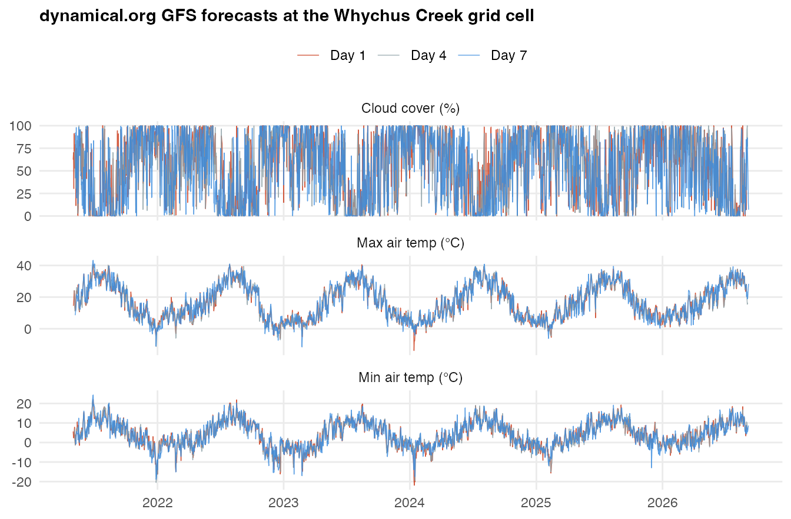

------------------------------------------------------------------------

## Part 2 — Superseded and reference datasets

### 2.1 all_historical_forecasts (superseded)

The air-temperature forecast archive the model was originally trained
on. **Do not use it as a forecast source.** It stores a single
air-temperature value per issue date, replicated identically across all
seven leads, so the entire day-1-to-day-7 forecast trajectory collapses
to one number. The defect is demonstrated in the [air temperature
source](https://flowwest.github.io/udwc_temperature/articles/air-temperature-source.md)
vignette.

It is retained so earlier analyses remain reproducible, and because the
`type == "historical weather"` rows are genuine ERA5 reanalysis
observations covering 2011–2018 — those are fine.

**Source.** [Open-Meteo Historical Forecast
API](https://open-meteo.com/en/docs/historical-forecast-api) for the
forecast rows (GFS archived model runs, 2019 onward) and the Open-Meteo
historical weather endpoint for the ERA5 rows (2011–2018), both at
44.390278 °N, −121.406792 °W.

`all_historical_forecasts`` ``|>`` `` `[`group_by`](https://dplyr.tidyverse.org/reference/group_by.html)`(``type``)`` ``|>`` `` `[`summarise`](https://dplyr.tidyverse.org/reference/summarise.html)`(``start ``=`` `[`format`](https://rdrr.io/r/base/format.html)`(`[`min`](https://rdrr.io/r/base/Extremes.html)`(``valid_date``, na.rm ``=`` ``TRUE``)``)``,`` `` end ``=`` `[`format`](https://rdrr.io/r/base/format.html)`(`[`max`](https://rdrr.io/r/base/Extremes.html)`(``valid_date``, na.rm ``=`` ``TRUE``)``)``,`` `` leads ``=`` `[`paste`](https://rdrr.io/r/base/paste.html)`(`[`sort`](https://rdrr.io/r/base/sort.html)`(`[`unique`](https://rdrr.io/r/base/unique.html)`(``lead_days``)``)``, collapse ``=`` ``", "``)``,`` `` n ``=`` `[`n`](https://dplyr.tidyverse.org/reference/context.html)`(``)``, .groups ``=`` ``"drop"``)`` ``|>`` `` ``knitr``::`[`kable`](https://rdrr.io/pkg/knitr/man/kable.html)`(``)`

| type                | start      | end        | leads               |     n |
|:--------------------|:-----------|:-----------|:--------------------|------:|
| historical forecast | 2019-01-01 | 2026-08-04 | 1, 2, 3, 4, 5, 6, 7 | 58233 |
| historical weather  | 2011-01-01 | 2018-12-31 | 0                   |  8766 |

`all_historical_forecasts`` ``|>`` `` `[`filter`](https://dplyr.tidyverse.org/reference/filter.html)`(``variable`` ``==`` ``"temperature_2m_max"``)`` ``|>`` `` `[`mutate`](https://dplyr.tidyverse.org/reference/mutate.html)`(``valid_date ``=`` `[`as.Date`](https://rdrr.io/r/base/as.Date.html)`(``valid_date``)``)`` ``|>`` `` `[`ggplot`](https://ggplot2.tidyverse.org/reference/ggplot.html)`(`[`aes`](https://ggplot2.tidyverse.org/reference/aes.html)`(``valid_date``, ``value``, colour ``=`` ``type``)``)`` ``+`` `` `[`geom_line`](https://ggplot2.tidyverse.org/reference/geom_path.html)`(``linewidth ``=`` ``0.25``, alpha ``=`` ``0.7``)`` ``+`` `` `[`scale_colour_manual`](https://ggplot2.tidyverse.org/reference/scale_manual.html)`(``values ``=`` `[`c`](https://rdrr.io/r/base/c.html)`(``"historical weather"`` ``=`` ``"#74A089"``,`` `` ``"historical forecast"`` ``=`` ``"#C93312"``)``)`` ``+`` `` `[`labs`](https://ggplot2.tidyverse.org/reference/labs.html)`(``title ``=`` ``"all_historical_forecasts — daily max air temperature"``,`` `` subtitle ``=`` ``"Retained for reproducibility; superseded as a forecast source"``,`` `` x ``=`` ``NULL``, y ``=`` ``"°C"``)`` ``+`` `` ``theme_inputs``(``)`

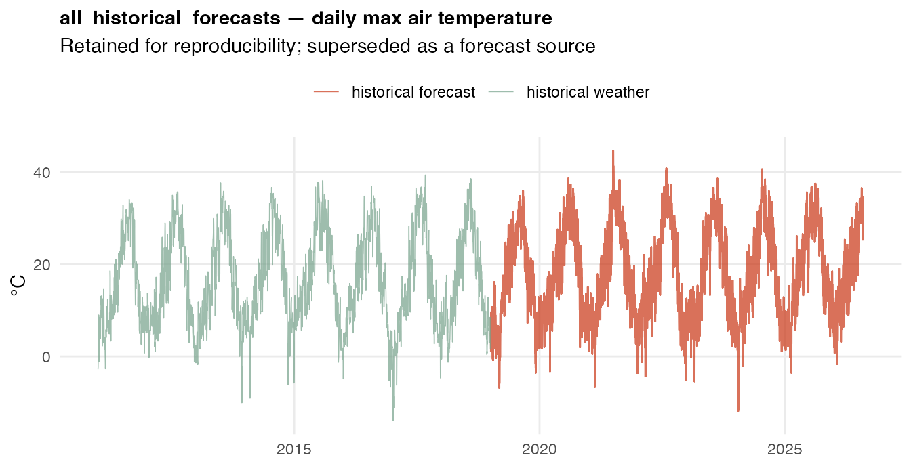

### 2.2 Sisters air temperature (GridMET)

Gridded *observed* daily air temperature near Sisters, Oregon. Not a
model input — it is the reference series used to score forecast archives
against reality, which is how the dynamical.org and legacy comparisons
were made. Its long record (1979 onward) also makes it the natural
baseline for judging how anomalous a given summer is.

**Source.** GridMET (~4 km gridded meteorology) pulled with
`climateR::getGridMET()` at 44.2896 °N, −121.5491 °W. Variables `tmmx`
and `tmmn`, converted from Kelvin; Fahrenheit columns are derived
conveniences.

`coverage``(``sisters_air_temp_historical``$``date``)`` ``|>`` ``knitr``::`[`kable`](https://rdrr.io/pkg/knitr/man/kable.html)`(``)`

| start      | end        | n_days | n_rows | n_years |
|:-----------|:-----------|-------:|-------:|--------:|
| 1979-01-01 | 2025-12-31 |  17167 |  17167 |      47 |

`sisters_air_temp_historical`` ``|>`` `` `[`filter`](https://dplyr.tidyverse.org/reference/filter.html)`(``date`` ``>=`` `[`as.Date`](https://rdrr.io/r/base/as.Date.html)`(``"2011-01-01"``)``)`` ``|>`` `` `[`select`](https://dplyr.tidyverse.org/reference/select.html)`(``date``, ``tmax_C``, ``tmin_C``)`` ``|>`` `` `[`pivot_longer`](https://tidyr.tidyverse.org/reference/pivot_longer.html)`(``-``date``)`` ``|>`` `` `[`ggplot`](https://ggplot2.tidyverse.org/reference/ggplot.html)`(`[`aes`](https://ggplot2.tidyverse.org/reference/aes.html)`(``date``, ``value``, colour ``=`` ``name``)``)`` ``+`` `` `[`geom_line`](https://ggplot2.tidyverse.org/reference/geom_path.html)`(``linewidth ``=`` ``0.2``, alpha ``=`` ``0.8``)`` ``+`` `` `[`scale_colour_manual`](https://ggplot2.tidyverse.org/reference/scale_manual.html)`(``values ``=`` `[`c`](https://rdrr.io/r/base/c.html)`(``tmax_C ``=`` ``"#DC863B"``, tmin_C ``=`` ``"#899DA4"``)``)`` ``+`` `` `[`labs`](https://ggplot2.tidyverse.org/reference/labs.html)`(``title ``=`` ``"Sisters, OR air temperature (GridMET)"``,`` `` subtitle ``=`` ``"Record extends back to 1979; 2011 onward shown"``,`` `` x ``=`` ``NULL``, y ``=`` ``"°C"``)`` ``+`` `` ``theme_inputs``(``)`

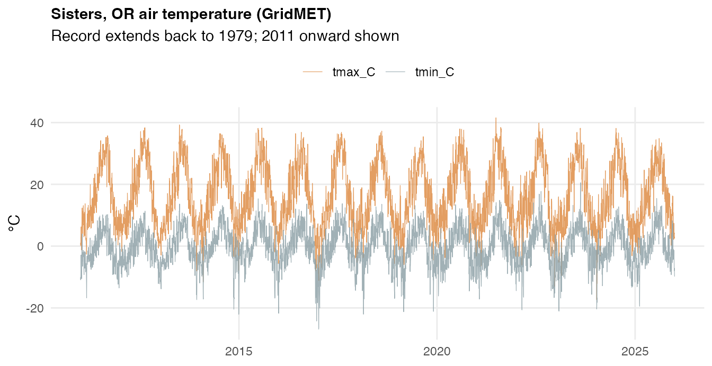

### 2.3 Sisters precipitation (GridMET)

Daily precipitation from the same GridMET pull, partitioned into rain
and snow at a 0 °C mean-temperature threshold. Not currently a model
input. Snowmelt timing is a plausible driver of summer baseflow, and
therefore of summer stream temperature, but that pathway is mediated by
discharge — which the model already observes directly at Camp Polk — so
precipitation has not earned a place in the predictor set.

**Source.** GridMET `pr` variable, same point and pull as section 2.2.

`coverage``(``sisters_precip_historical``$``date``)`` ``|>`` ``knitr``::`[`kable`](https://rdrr.io/pkg/knitr/man/kable.html)`(``)`

| start      | end        | n_days | n_rows | n_years |
|:-----------|:-----------|-------:|-------:|--------:|
| 1979-01-01 | 2025-12-31 |  17167 |  17167 |      47 |

`sisters_precip_historical`` ``|>`` `` `[`filter`](https://dplyr.tidyverse.org/reference/filter.html)`(``date`` ``>=`` `[`as.Date`](https://rdrr.io/r/base/as.Date.html)`(``"2011-01-01"``)``)`` ``|>`` `` `[`mutate`](https://dplyr.tidyverse.org/reference/mutate.html)`(``year ``=`` `[`as.integer`](https://rdrr.io/r/base/integer.html)`(`[`format`](https://rdrr.io/r/base/format.html)`(``date``, ``"%Y"``)``)``)`` ``|>`` `` `[`group_by`](https://dplyr.tidyverse.org/reference/group_by.html)`(``year``)`` ``|>`` `` `[`summarise`](https://dplyr.tidyverse.org/reference/summarise.html)`(``rain_mm ``=`` `[`sum`](https://rdrr.io/r/base/sum.html)`(``rain_mm``, na.rm ``=`` ``TRUE``)``,`` `` snow_mm ``=`` `[`sum`](https://rdrr.io/r/base/sum.html)`(``snow_mm``, na.rm ``=`` ``TRUE``)``, .groups ``=`` ``"drop"``)`` ``|>`` `` `[`pivot_longer`](https://tidyr.tidyverse.org/reference/pivot_longer.html)`(``-``year``)`` ``|>`` `` `[`ggplot`](https://ggplot2.tidyverse.org/reference/ggplot.html)`(`[`aes`](https://ggplot2.tidyverse.org/reference/aes.html)`(``year``, ``value``, fill ``=`` ``name``)``)`` ``+`` `` `[`geom_col`](https://ggplot2.tidyverse.org/reference/geom_bar.html)`(``)`` ``+`` `` `[`scale_fill_manual`](https://ggplot2.tidyverse.org/reference/scale_manual.html)`(``values ``=`` `[`c`](https://rdrr.io/r/base/c.html)`(``rain_mm ``=`` ``"#378ADD"``, snow_mm ``=`` ``"#899DA4"``)``)`` ``+`` `` `[`labs`](https://ggplot2.tidyverse.org/reference/labs.html)`(``title ``=`` ``"Sisters, OR annual precipitation by phase"``,`` `` x ``=`` ``NULL``, y ``=`` ``"mm"``)`` ``+`` `` ``theme_inputs``(``)`

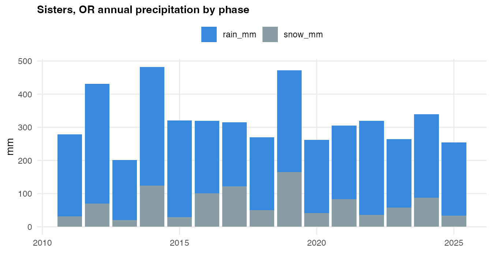

------------------------------------------------------------------------

## Part 3 — Other monitoring sites

These were compiled while scoping the project and are not used by the RM
8.5 model. They are documented here so the package contents are fully
accounted for.

### 3.1 RM 6 in-stream temperature

Whychus Creek at river mile 6, about 2.5 miles downstream of RM 8.5. The
original project scope included an RM 6 forecast, and `lm_rm6_7dadm` in
this package is a linear model fit to it. RM 6 is not a predictor of RM
8.5 — it is downstream, so it carries no information the forecast could
use.

**Source.** UDWC continuous temperature monitoring, monitoring location
`WC_006-00`. Between one and three loggers are in the stream at any
time; readings are averaged across all loggers present before daily
statistics are computed.

`coverage``(``rm_6_historical``$``date``)`` ``|>`` ``knitr``::`[`kable`](https://rdrr.io/pkg/knitr/man/kable.html)`(``)`

| start      | end        | n_days | n_rows | n_years |
|:-----------|:-----------|-------:|-------:|--------:|
| 2012-04-23 | 2025-10-17 |   2492 |  12460 |      13 |

`plot_instream``(``rm_6_historical``, title ``=`` ``"RM 6 in-stream temperature"``)`

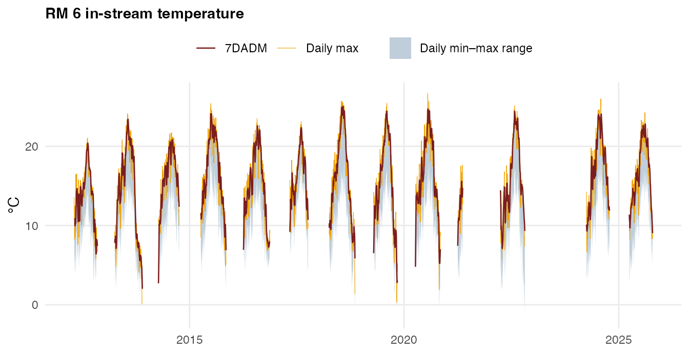

### 3.2 Whychus Creek near Sisters

Upstream of the town of Sisters, and upstream of Camp Polk. Collects
both water temperature and discharge. It sits further from RM 8.5 than
Camp Polk does and its signal is largely subsumed by the Camp Polk
record, so it is not in the predictor set — but it is the natural
fallback if Camp Polk telemetry fails.

**Source.** OWRD station **14075000**, via
[`get_owrd_hydro()`](https://flowwest.github.io/udwc_temperature/reference/get_owrd_hydro.md).

`coverage``(``whychus_nr_sisters_historical``$``date``)`` ``|>`` ``knitr``::`[`kable`](https://rdrr.io/pkg/knitr/man/kable.html)`(``)`

| start      | end        | n_days | n_rows | n_years |
|:-----------|:-----------|-------:|-------:|--------:|
| 2011-01-01 | 2026-04-15 |   5584 |  16855 |      16 |

`whychus_nr_sisters_historical`` ``|>`` `` `[`ggplot`](https://ggplot2.tidyverse.org/reference/ggplot.html)`(`[`aes`](https://ggplot2.tidyverse.org/reference/aes.html)`(`[`as.Date`](https://rdrr.io/r/base/as.Date.html)`(``date``)``, ``value``, colour ``=`` ``statistic``)``)`` ``+`` `` `[`geom_line`](https://ggplot2.tidyverse.org/reference/geom_path.html)`(``linewidth ``=`` ``0.3``)`` ``+`` `` `[`facet_wrap`](https://ggplot2.tidyverse.org/reference/facet_wrap.html)`(``~``variable``, ncol ``=`` ``1``, scales ``=`` ``"free_y"``)`` ``+`` `` `[`scale_colour_manual`](https://ggplot2.tidyverse.org/reference/scale_manual.html)`(``values ``=`` ``stat_colors``)`` ``+`` `` `[`labs`](https://ggplot2.tidyverse.org/reference/labs.html)`(``title ``=`` ``"Whychus Cr nr Sisters, OR — OWRD 14075000"``,`` `` x ``=`` ``NULL``, y ``=`` ``NULL``)`` ``+`` `` ``theme_inputs``(``)`

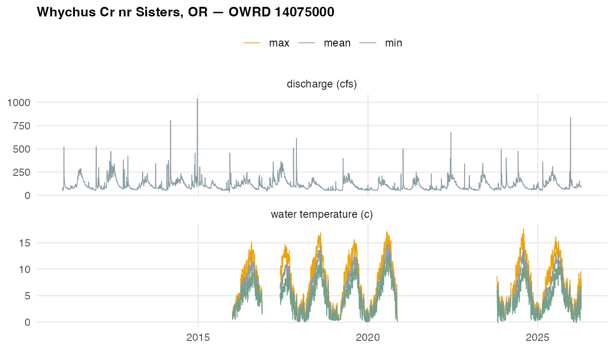

### 3.3 Whychus Creek at Sisters

In the town of Sisters. Discharge only — no temperature. The longest
flow record in the package, back to 2001.

**Source.** OWRD station **14076050**, `MDF` series, via
[`get_owrd_hydro()`](https://flowwest.github.io/udwc_temperature/reference/get_owrd_hydro.md).

`coverage``(``whychus_at_sisters_historical``$``date``)`` ``|>`` ``knitr``::`[`kable`](https://rdrr.io/pkg/knitr/man/kable.html)`(``)`

| start      | end        | n_days | n_rows | n_years |
|:-----------|:-----------|-------:|-------:|--------:|
| 2001-01-01 | 2026-06-10 |   9292 |   9292 |      26 |

`whychus_at_sisters_historical`` ``|>`` `` `[`ggplot`](https://ggplot2.tidyverse.org/reference/ggplot.html)`(`[`aes`](https://ggplot2.tidyverse.org/reference/aes.html)`(`[`as.Date`](https://rdrr.io/r/base/as.Date.html)`(``date``)``, ``value``)``)`` ``+`` `` `[`geom_line`](https://ggplot2.tidyverse.org/reference/geom_path.html)`(``linewidth ``=`` ``0.25``, colour ``=`` ``"#378ADD"``)`` ``+`` `` `[`scale_y_log10`](https://ggplot2.tidyverse.org/reference/scale_continuous.html)`(``)`` ``+`` `` `[`labs`](https://ggplot2.tidyverse.org/reference/labs.html)`(``title ``=`` ``"Whychus Cr at Sisters, OR — OWRD 14076050"``,`` `` x ``=`` ``NULL``, y ``=`` ``"Mean daily flow, cfs (log scale)"``)`` ``+`` `` ``theme_inputs``(``)`

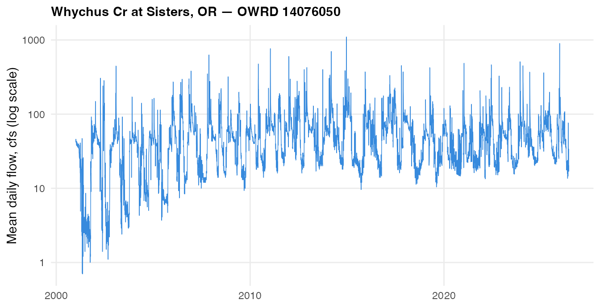

### 3.4 Sub-daily logger records

`all_rm_8_5_dates_and_times` and `all_rm_6_dates_and_times` hold the
individual logger readings behind `rm_8_5_historical` and
`rm_6_historical`, so the daily statistics can be recomputed without
re-reading the annual Excel workbooks.

[`bind_rows`](https://dplyr.tidyverse.org/reference/bind_rows.html)`(`` `` `[`cbind`](https://rdrr.io/r/base/cbind.html)`(``dataset ``=`` ``"all_rm_8_5_dates_and_times"``, ``coverage``(``all_rm_8_5_dates_and_times``$``date``)``)``,`` `` `[`cbind`](https://rdrr.io/r/base/cbind.html)`(``dataset ``=`` ``"all_rm_6_dates_and_times"``, ``coverage``(``all_rm_6_dates_and_times``$``date``)``)`` ``)`` ``|>`` `` ``knitr``::`[`kable`](https://rdrr.io/pkg/knitr/man/kable.html)`(``)`

| dataset                    | start      | end        | n_days | n_rows | n_years |
|:---------------------------|:-----------|:-----------|-------:|-------:|--------:|
| all_rm_8_5_dates_and_times | 2011-04-28 | 2025-10-29 |   2855 |  73502 |      14 |
| all_rm_6_dates_and_times   | 2012-04-23 | 2025-10-17 |   2492 |  75514 |      13 |

**Only the RM 6 object retains time of day.** The RM 6 compilation adds
the workbook’s `TIME` column onto the date, giving genuine hourly
timestamps; the RM 8.5 compilation does not, so every RM 8.5 reading is
stamped at midnight and the several readings that share a date are
indistinguishable. Check before using either object for anything
sub-daily:

[`data.frame`](https://rdrr.io/r/base/data.frame.html)`(`` `` dataset ``=`` `[`c`](https://rdrr.io/r/base/c.html)`(``"all_rm_8_5_dates_and_times"``, ``"all_rm_6_dates_and_times"``)``,`` `` distinct_hours ``=`` `[`c`](https://rdrr.io/r/base/c.html)`(`` `` `[`length`](https://rdrr.io/r/base/length.html)`(`[`unique`](https://rdrr.io/r/base/unique.html)`(`[`format`](https://rdrr.io/r/base/format.html)`(``all_rm_8_5_dates_and_times``$``date``, ``"%H"``, tz ``=`` ``"UTC"``)``)``)``,`` `` `[`length`](https://rdrr.io/r/base/length.html)`(`[`unique`](https://rdrr.io/r/base/unique.html)`(`[`format`](https://rdrr.io/r/base/format.html)`(``all_rm_6_dates_and_times``$``date``, ``"%H"``, tz ``=`` ``"UTC"``)``)``)`` `` ``)`` ``)`` ``|>`` `` ``knitr``::`[`kable`](https://rdrr.io/pkg/knitr/man/kable.html)`(``)`

| dataset                    | distinct_hours |
|:---------------------------|---------------:|
| all_rm_8_5_dates_and_times |              1 |
| all_rm_6_dates_and_times   |             24 |

Timestamps are the logger’s local clock time, carried without a
timezone.

`all_rm_6_dates_and_times`` ``|>`` `` `[`mutate`](https://dplyr.tidyverse.org/reference/mutate.html)`(``hour ``=`` `[`as.integer`](https://rdrr.io/r/base/integer.html)`(`[`format`](https://rdrr.io/r/base/format.html)`(``date``, ``"%H"``, tz ``=`` ``"UTC"``)``)``,`` `` month ``=`` `[`as.integer`](https://rdrr.io/r/base/integer.html)`(`[`format`](https://rdrr.io/r/base/format.html)`(``date``, ``"%m"``, tz ``=`` ``"UTC"``)``)``)`` ``|>`` `` `[`filter`](https://dplyr.tidyverse.org/reference/filter.html)`(``month`` ``>=`` ``5``, ``month`` ``<=`` ``10``)`` ``|>`` `` `[`group_by`](https://dplyr.tidyverse.org/reference/group_by.html)`(``hour``)`` ``|>`` `` `[`summarise`](https://dplyr.tidyverse.org/reference/summarise.html)`(``temperature ``=`` `[`mean`](https://rdrr.io/r/base/mean.html)`(``temperature``, na.rm ``=`` ``TRUE``)``, .groups ``=`` ``"drop"``)`` ``|>`` `` `[`ggplot`](https://ggplot2.tidyverse.org/reference/ggplot.html)`(`[`aes`](https://ggplot2.tidyverse.org/reference/aes.html)`(``hour``, ``temperature``)``)`` ``+`` `` `[`geom_line`](https://ggplot2.tidyverse.org/reference/geom_path.html)`(``linewidth ``=`` ``0.7``, colour ``=`` ``"#C93312"``)`` ``+`` `` `[`geom_vline`](https://ggplot2.tidyverse.org/reference/geom_abline.html)`(``xintercept ``=`` ``19``, linetype ``=`` ``"dashed"``, colour ``=`` ``"grey40"``)`` ``+`` `` `[`scale_x_continuous`](https://ggplot2.tidyverse.org/reference/scale_continuous.html)`(``breaks ``=`` `[`seq`](https://rdrr.io/r/base/seq.html)`(``0``, ``23``, ``3``)``)`` ``+`` `` `[`labs`](https://ggplot2.tidyverse.org/reference/labs.html)`(``title ``=`` ``"RM 6 mean diurnal cycle, May–October"``,`` `` subtitle ``=`` ``"Daily maximum falls around 17:00; dashed line is the 7 pm model run time"``,`` `` x ``=`` ``"Hour of day"``, y ``=`` ``"°C"``)`` ``+`` `` ``theme_inputs``(``)`

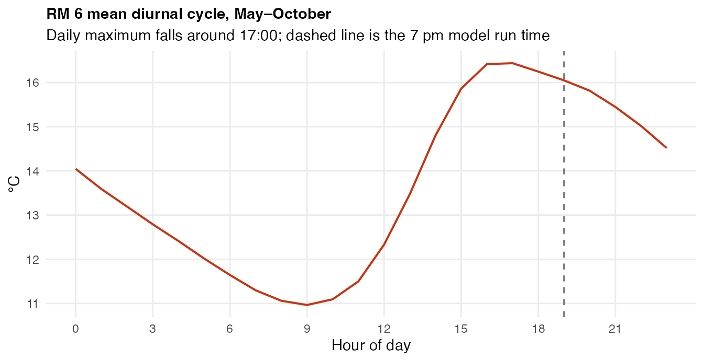

This diurnal shape is why the model is allowed to use RM 8.5’s
*same-day* 7DADM as a predictor: at a 7 pm run time the daily maximum
has already occurred. RM 6 is shown here only because it is the object
that kept its timestamps — the check that actually licenses the 7 pm run
time was made directly against the raw 2026 RM 8.5 logger export, where
the daily maximum landed after 7 pm on 0% of days and after 6 pm on
4.1%.

------------------------------------------------------------------------

## Refreshing the data

| Dataset | How to refresh |
|----|----|
| RM 8.5, RM 6, Camp Polk logger | Add the new annual UDWC workbook to `data-raw/historical-temperature/`, add a chunk in `pull-historical-data.Rmd`, re-knit |
| Camp Polk, Whychus nr/at Sisters (OWRD) | Re-knit the relevant `eval=FALSE` chunk in `pull-historical-data.Rmd`; [`get_owrd_hydro()`](https://flowwest.github.io/udwc_temperature/reference/get_owrd_hydro.md) pulls to [`Sys.Date()`](https://rdrr.io/r/base/Sys.time.html) |
| dynamical.org GFS | Run `data-raw/pull_dynamical_forecasts.py --start-date <date> --append` to extend the CSV, then re-knit the dynamical.org chunk in `pull-historical-data.Rmd` to rebuild `dynamical_gfs_forecasts` |
| Sisters air temp and precip | Re-run the `climateR::getGridMET()` chunk with a later `END_DATE` |
| `all_historical_forecasts` | Superseded — extend the dynamical.org CSV instead |

In-season 2026 RM 8.5 logger exports are deliberately **not** folded
into the package object. They are bound on at fit time in
`analysis/rm85-rf-extended-training.Rmd`, which keeps the shipped
historical record stable while an incomplete season is still
accumulating.
